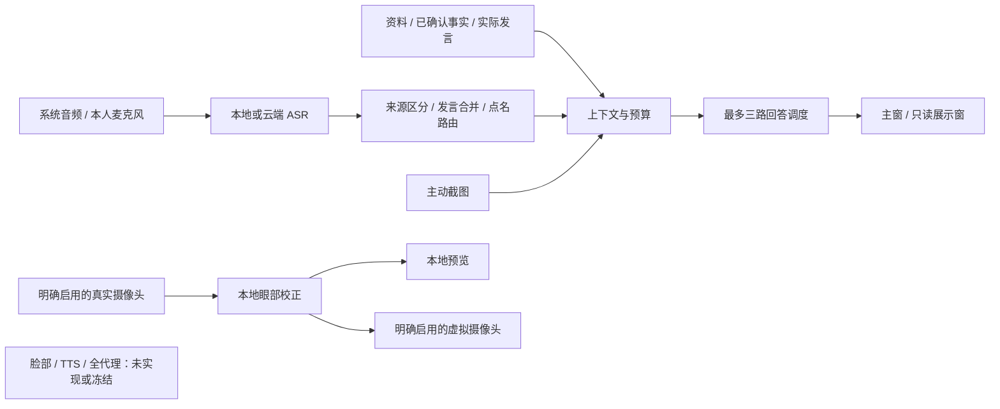

<!-- Public copy: personal local paths replaced; original is retained in the private handoff. -->
# 听弦 · 后续演进产品需求文档

> **2026-11-06 修订：** 摄像头增强、数字人及开发优先级由 [PRD v2.1](PRD-v2.1-eye-face.md) 覆盖。R10 改为本地眼部校正 R10E 优先，脸部替换 R10F 仅保留禁用入口与接口，R11 全程代理冻结。R01—R09 与既有验收要求继续有效。旧路线见[冻结归档](https://github.com/Jinchun-Liu/TingXian/blob/2a80d7bf280d75d67ab985fe6cd10f10b095f5e9/docs/avatar-freeze-2026-11-06.md)。Windows 源码起点为 a152bbb；安装问题未解除。界面以用户指定的已发布 Mac 0.6.5（f80ba86）为基准，保留平台提示和资料保护修复。

**原始文档版本：v2.0｜日期：2026-11-05｜当前产品基线：0.6.5｜状态：后续需求草案，未启动实施**

> 听弦：结合你的资料、理解对话上下文的开源实时交流助手。
>
> 本文汇总既有需求、当前进展及未完成想法。保留已验证能力，补齐实际环境验收，再推进商用转写、Windows、本地眼部校正和开源生态。文档版本不等于软件发布版本；下面的性能数字均为验收目标或探索目标，不是现有实测成绩。

## 1. 产品方向与约束

### 1.1 用户已经确定的方向

1. **全开源、软件免费。** 目标是实用性、GitHub 关注、开发者参与和行业影响力，不以付费转化为产品指标。用户自备的云服务可能收费，必须与软件免费区分。
2. **实时对话辅助。** 持续记录双方实际发言；本人发言作为上下文，默认不触发 AI；对方完成发言后按场景规则生成建议。
3. **高频交流中可读。** 默认只突出问答，支持历史、字号、拆窗和阅读位置锁定，降低寻找答案的负担。
4. **个性化但可核对。** 背景资料自动整理、原文检索、事实与练习分离；模型建议不能自动变成真实经历。
5. **多模型可选。** 不同问题最多三路并行；背景整理、视觉、后续转写和本地眼部校正使用各自适合的模型与配置。
6. **中国大陆网络优先。** 商用实时转写必须在目标环境证明低于当前本地路径的延迟；无需开展漫无边际的模型准确率排名。
7. **256K 调试基线。** 资料与请求预算以 262,144 tokens 为应用调试上限，不能因为服务商提供更大窗口就默认发送整库。
8. **跨平台拓展。** 已有 Mac；另有 RTX 4070 Ti SUPER 台式机，可用于 Windows 和本地眼部校正测试。
9. **本地眼部优先。** R10E 修正真实摄像头的眼区，保留真实口型、声音、身体和背景；R10F 脸部替换仅预留界面与接口。旧完整数字人、照片注册、口型、TTS 与 R11 自动代理冻结。
10. **界面原则。** “Avoid unnecessary secondary labels and descriptions. Let the layout do the explaining.”

### 1.2 本文提出、尚未形成发布承诺的方案

以下是为落实愿景提出的产品方案：后台整理断点续作、资料交换格式完善、Windows 首发边界、眼部校正性能门槛、公开评测集、增长指标和里程碑顺序。它们应在对应阶段评审后成为实施基线，不代表用户已指定供应商、同意新增费用或承诺发布日期。

历史数字人代理需求保存在归档，不列入当前开发任务。新视觉功能面向模拟面试、练习以及参与者明确允许的交流；眼部校正仍展示本人真实面貌。产品不承诺隐蔽代考、绕过真人验证、无法被识别，或任何会议软件中的绝对不可见。

### 1.3 本次交付边界

原 v2.0 的编写轮次只产出需求文档。2026-11-06 当前轮次执行旧路线保全、独立 Windows 源码基线、v2.1 同步与基础检查；没有启动眼部/脸部新功能、摄像头、音频或真实 AI。现有安装和用户资料不变。实际结果见[恢复记录](windows-eye-baseline-2026-11-06.md)。

## 2. 当前进展与证据

### 2.1 核对基线

以下为原 Mac 0.6.5 历史快照，不代表当前 Windows 实测。当前 Windows 选定 a152bbb，保留 2dd84b3 保存修复；验收边界见进度账本与 v2.1 第 2 节。

- 公开仓库：[Jinchun-Liu/TingXian](https://github.com/Jinchun-Liu/TingXian)。
- 本地公开源码当前提交：`f80ba86b85a1a862bf8daefe22848743629bc3c8`。
- 本次只读检查 `/Applications/听弦.app/Contents/Info.plist`，安装版本为 **0.6.5**；未操作当前窗口。
- [0.6.5 发布页](https://github.com/Jinchun-Liu/TingXian/releases/tag/v0.6.5)有 Apple Silicon 安装包，标记为预发布；README 推荐下载仍为 0.5.1，稳定与预发布入口需要在验收后统一说明。
- 本机验收记录确认过升级、安装资源与已保存会话一致性；本次没有重新执行这些测试。
- 既有验证文档有版本差异：`docs/INTERVIEW-VALIDATION.md`主要描述早期版本，不能用其中的测试数量代替 0.6.5 的完整验收。

状态口径：**已有实现**代表源码或发布物存在；**局部验证**代表只在记录所述范围通过；**待统一验收**不代表功能不存在；**新增/探索**代表本轮没有找到完整交付证据。

### 2.2 功能盘点

| 能力 | 当前状态 | 后续工作 |
|---|---|---|
| 系统音频与可选本人麦克风 | 已有实现；实际扬声器短测、启停和恢复有记录 | 长通话、设备拔插、权限拒绝与重试统一验收 |
| Whisper small、多语言配置、整段复核 | 已有实现；专名仍有误识别 | 商用流式 ASR 接入；保留本地降级 |
| 本人仅入上下文、对方完整发言触发 | 已有实现及历史联测反馈 | 云 ASR、多人、数字人加入后维持来源边界 |
| 自适应长短回答、答案先出、纠正问题后出 | 已有实现 | 长题覆盖率、流式协议及空白失败状态验收 |
| 三个独立回答接口、三题并行、第四题排队 | 已有实现与回归记录 | 真实 API 限流、乱序完成、依赖追问验收 |
| 默认隐藏本人发言、历史与一问一答阅读 | 已有实现 | 密集对话、检索历史及无障碍回归 |
| 拆分控制窗与展示窗、字号大中小 | 已有实现 | 双屏、窄窗、Windows 与 iPad 扩展屏验证 |
| 答复自动跟随、手动浏览锁定、返回最新答复 | 0.6.5 已实现并做过页面实测 | 最新安装版长会话回归；字幕不得夺取位置 |
| 会话保存/恢复/导出、一键清空 | 已有实现；保存后重启有核对记录 | 崩溃恢复范围明确化；旧版本迁移回归 |
| 目录/重点文件导入、FTS5 检索、事实卡 | 已有实现 | 大资料量、增量变化、冲突和失效处理验收 |
| 独立背景模型、逐文件整理、预览应用 | 已有实现 | 任务持久化、断点续作及长任务可用性完善 |
| Codex / Claude Code 整理 Skill 与脚本导出 | 已有实现 | 两个真实 Agent 的安装、处理、回导联合验收 |
| 整库估算、单次预算、API usage 计量 | 已有实现；本地为 UTF-8 字节保守估计 | 精确口径、模型能力配置及预算裁剪完善 |
| 五种参会模式与称呼触发 | 已有实现及规则测试 | 真实多人误报/漏报、叠音、点名追问验收 |
| 截图问答、独立视觉接口 | 已有实现及消息载荷测试 | 真实视觉 API、多屏截图、复杂题目验收 |
| 听弦名称、图标、主题色和统一控件 | 已在产品中实施 | 统一视觉巡检，保持用户指定风格 |
| macOS 独立安装包与 GitHub 发布 | 已交付；个人开发包未公证 | 稳定通道、升级恢复、安装信任体验完善 |
| 飞书双设备 30 题、约 60 分钟完整验收 | **待完成** | 第一阶段发布门槛；不能用旧短测或合成演示替代 |
| 商用实时语音识别 | **尚无本轮可确认的听弦完整接入** | 优先选定一个大陆区域服务形成闭环 |
| Windows 产品发布 | **未验收**；存在上游平台代码 | 听弦实际功能适配、安装、音频与 GPU 验证 |
| iPad 独立客户端 / 局域网展示服务 | **未实现** | 先验证系统扩展屏；原生客户端暂缓 |
| 本地眼部校正与虚拟摄像头 | **需求已确定，未实现** | R10E 独立可选运行时与分层验收；脸部仅预留接口 |
| 完整数字人与全程代理 | **冻结** | 源码、试验及历史需求保存在独立归档 |
| 公开评测、背景交换规范、系统推广 | **后续产品与社区工作** | 分阶段产出，不把 Stars 数量作为软件验收条件 |

### 2.3 替代旧 PRD 的规则

旧 v1.0 中“暂不做 Windows、云 ASR、截图和自动发言”等是首版边界：截图已经扩展，Windows 和云 ASR 纳入后续阶段；授权代理现按 v2.1 冻结。旧版固定回答章节、默认不自动跟随等规则，以用户后续要求和 0.6.5 的现行行为为准。

保留：原资料只读、本人事实与 AI 建议分离、可取消、来源可核对、离线降级、真实音频验收。不得因重构丢失既有功能或改变旧数据含义。

## 3. 用户场景与成功标准

| 场景 | 用户的主要动作 | 成功表现 |
|---|---|---|
| 面试准备 | 选择资料夹，填写岗位，审阅背景草稿 | 无需手工重排文件，能看到逐文件结果和缺口 |
| 一对一 / 多对一问答 | 持续聆听，自己回答，查看建议 | 对方完整问题触发，本人不触发；追问理解实际说过的内容 |
| 群面 / 多人会议 | 配置称呼，持续记录 | 叫到本人时提醒并提供建议，其余内容只记录 |
| 屏幕技术题 | 点击截图提问 | 识别当前题目并结合对话回答，不编造模糊代码 |
| 阅读历史 | 滚轮翻看、搜索、回到最新 | 新字幕和其他问题的流式内容不抢阅读位置 |
| 跨屏使用 | 将展示窗移动到副屏或 iPad | 控制与展示独立，断开外屏可恢复窗口 |
| 本地眼部校正 | 明确启用真实摄像头、本地预览及虚拟视频输出 | 保留真实嘴部、声音和身体；闭眼与失效行为正确，可立即停止 |
| 脸部替换 / 自动代理 | 当前不可启动 | 脸部仅规划接口，自动代理冻结；不下载模型或隐式外发 |
| 开源试用与贡献 | 下载、运行示例、复现问题或提交修改 | 不依赖维护者陪同即可体验或开发 |

首要产品指标：目标环境中的成功使用率、有效回答延迟、事实正确性、持续运行稳定性、用户重复使用反馈。Stars、下载量、贡献者和下游采用分别统计，不能互相替代。

## 4. 实施优先级

| 优先级 | 范围 | 原因 |
|---|---|---|
| P0 | 冻结归档、a152bbb Windows 独立基线、安装阻塞、资料与输入恢复 | 先保全并维持基础链路；防护开启时完整安装仍待通过 |
| P1 | 商用流式 ASR、复杂问答质量、RAG 任务与预算完善、真实视觉验收 | 直接解决转写、回答拥挤和配置门槛 |
| P1 | Windows 基础版、双屏与 iPad 扩展屏验证、首次体验 | 扩大可用范围，支持现有测试硬件 |
| P1 | 本地眼部校正、预览、虚拟摄像头与停止恢复 | 仅指新视觉功能内部顺序，不取消原有 P1 |
| P2 | 多人场景强化、公开评测与生态材料 | 在已有闭环上提高复用价值 |
| P3 | 脸部替换禁用界面与适配契约、独立 iPad 展示服务 | 脸部调用返回 not_implemented，无媒体副作用 |
| 延后 / 冻结 | 脸部模型、TTS、虚拟麦克风、旧完整数字人及 R11 代理 | 另行明确范围，本轮不实现 |

P1 内可以独立推进，但不能以新功能测试代替 P0。推广材料可以提前准备；大范围传播应等待推荐版本具备完整验收证据。眼部运行时采用可关闭的独立模块，不阻塞普通转写与问答发布；旧数字人路线不再作为当前里程碑。

## 5. R01：稳定性与现有链路收口

### 5.1 会话生命周期

保留状态：就绪 → 启动中 → 聆听中 → 暂停/停止中 → 已停止；任何启动失败都必须进入可恢复状态。音频采集、回答任务、数字人输出各有独立状态，不能只用一个“运行中”覆盖全部模块。

- 开始操作防重复点击，返回真实启动结果；权限失败、无效设备、模型失败均显示可操作原因。
- 停止采集必须释放设备与工作任务，允许再次开始；不把“停止”写成“已保存”。
- 清空历史先结束属于当前会话的请求与输出，再更新视图和调用统计；迟到事件不能重新填回旧答案。
- 本人麦克风开关独立于飞书等会议软件。不得在无法可靠读取会议软件状态时显示“已随飞书静音”。
- 保存、恢复、浏览历史不能自动开启采集、云请求或代理输出。
- 升级保留资料、设备偏好及已保存会话；数据库变更先检查版本和可恢复快照，不覆盖不可读的旧库。

### 5.2 故障与恢复

- AI 卡片必须明确属于排队、生成中、完成、部分完成、失败或取消，禁止长期空白但看起来已完成。
- 一题失败不清空其他题；保留已生成正文与重试入口，重试产生新修订号。
- 429、超时、断网采用有限重试及退避。不得将旧问题无限重排造成费用和拥挤。
- **新增建议：** 增量保存当前会话的可恢复快照，清楚区分“恢复草稿”与用户正式保存；恢复时仍不自动重发。
- 磁盘不足先提示并保留当前可用版本，不在应用内擅自删除资料、模型或编译缓存。

### 5.3 验收

30 题 / 60 分钟完整通话无崩溃、无无法恢复的启动状态、无永久任务积压；停止再启至少三次成功。保存并重启后记录、答案、来源、调用统计一致。清空后旧请求不得重新出现。断网与错误接口用例有明确状态，不以重启软件作为常规恢复方式。

## 6. R02：商用流式转写与上下文纠错

### 6.1 服务选择

先实现统一 ASR 接口和一个服务商适配；第二家在首家实测不满足需求或出现可靠性问题后接入。初选范围是中国大陆区域的阿里云实时语音识别与火山引擎双向流式识别，两者官方文档均提供流式路径。[阿里云实时识别](https://help.aliyun.com/en/model-studio/real-time-speech-recognition-user-guide) · [火山引擎流式识别](https://docs.volcengine.com/docs/doubao-voice/large-model-streaming-automatic-speech-recognition-api-1?lang=en)

选型记录必须包括：实际模型 ID、区域、接入协议、partial/final 语义、热词能力、会话时长限制、断流续接方式、账户并发和计费单位。供应商宣称的延迟不视为听弦端到端结果。

### 6.2 产品行为

1. 音频设置支持“本地 / 云端”。本地 small 继续可用，无 Key 不阻止本地转写。
2. 云 ASR 使用独立配置和凭证；用户明确启用后才发送对应音频流。本人音频是否发送跟随本人采集开关。
3. 双路音频保留来源标识；不能把本人和对端混为一个没有来源的文本流。
4. partial 仅更新实时字幕；final 是文本定稿信号，是否触发回答还需经过完整发言与场景规则。
5. 热词来自经过确认的项目名称、技术词、称呼和岗位词；支持同音词，但不能把 null、零、空串等不同含义设为同义词。
6. 会话开始、暂停、恢复、断流、重连、服务商时长到期都需要连续的事件编号和去重。用户主动停止后不得自动重连。
7. 云端失败时可按用户预先选定策略切回本地，界面提示实际模式；没有本地模型时提示缺失，不假装切换成功。

### 6.3 纠错与发言边界

- 保留原始转写、最终转写与 AI 理解后的问题，三者不互相覆盖。
- 先依靠 ASR final、停顿和文本连续性合并发言；“同一大题里的多个条件”不因短暂停顿拆成多个无上下文问题。
- 上下文纠错只修有依据的专名与近音词；涉及否定、数字、版本、约束时保守处理，不靠个人资料强行改写对方真正说法。
- AI 回答可以在内部理解问题，但 UI 继续先输出答案，再输出纠正后的完整问题。
- 人工编辑问题形成新修订；取消旧请求，过期输出不得写入新卡片。

### 6.4 验收

使用同一组至少 30 段目标语音，在同一设备、相同网络时段交替测试云端与本地。记录最后发声到 final 可用的 P50/P95；推荐云端配置必须两项均低于本地基线。未达到则不标成更快，不取消本地路径。

不开展大规模通用准确率排名，但必须通过产品冒烟集：StockMarketAgent、契约测试、JSON Schema、pytest、FastAPI、幂等键、HTTP 504、null / 0 / 缺失字段 / 空字符串，以及含否定词和连续条件的长题。明显语义反转必须进入失败样本，不得通过“语句更通顺”掩盖。

## 7. R03：回答质量、三路并发与阅读

### 7.1 回答长度

长度由任务决定，不单按问题字符数判断。以下区间是默认提示策略，不能截断必要答案：

| 类型 | 默认呈现 | 例子 |
|---|---|---|
| 简短事实 / 单概念 | 2–4 句，通常 80–180 中文字 | “幂等键是什么？” |
| 多条件 / 多子问题 | 先结论，再 3–6 个必要要点，通常 250–500 字 | “比较两种实现，并给出故障与验证方法” |
| 代码 / SQL / 测试设计 | 必要代码或步骤 + 简短说明，不为字数省掉关键条件 | “写出区分 null、0 和缺失字段的测试” |
| 不确定的个人经历 | 明确资料不足，提供可由本人补充的结构 | “你生产事故中的实际职责是什么？” |

复杂问题必须覆盖所有显式子问题。问题虽然很长但只问一个简单事实时仍可简答。默认不增加“思考过程、分析思路、识图过程、可能追问”等固定段落；用户主动要求时再提供。

### 7.2 输出顺序与错误状态

- 正文流式显示，不等待问题纠错完成；正文结束后显示纠正后的完整问题。
- 协议分隔符不得短暂出现在 UI；缺少纠正问题时回退原问句，不伪造纠错结果。
- 长题超时保留已生成正文并标明未完成，可续答或重试；不能显示空卡片。
- 来源证据放在按需展开区，仍可访问，不占据默认答案阅读区域。

### 7.3 并发与上下文

- 保留三个回答位置，**不同问题分配不同可用位置**，不是同一问题自动生成三份答案。
- 每题绑定会话、发言、修订、提供方和上下文版本；完成顺序不同不能串题。
- 超过三题进入有界队列，显示可取消项；过时任务可取消或重提，不能静默丢弃。
- 每次提交记录上下文快照；依赖本人最新实际回答的追问，包含该实际回答。
- “你刚才的方法”存在指代歧义时先结合实际发言，不把上一题尚未读出的 AI 建议当成本人说过。
- 截图任务也受总体并发限制，独立的视觉位置不代表无限并发。
- 代理发言模式可以并行准备答案，但对外播放永远串行，详见 R11。

### 7.4 阅读规则

延续 0.6.5：默认跟随最新 AI 正文；滚轮、触摸或键盘翻阅暂停跟随；点击“返回最新答复”恢复。原始字幕、本人发言、纠正问题、新的等待卡片不得独立拉动阅读区域。三路同时生成时，按问题时间及用户选中项稳定定位，不能在三个卡片之间来回跳转。

验收至少包含：20 道短题、10 道多条件长题、5 道代码/SQL 题；对长题标注子问题，目标覆盖率 ≥90%，关键否定/数值条件不得遗漏。新增指标是建议门槛，需随测试记录发布，不能用文字长度代替质量评分。

## 8. R04：背景资料自动化与可移植 Skill / Harness

### 8.1 延续现有工作流

选择文件夹或重点文件 → 逐份读取 → 逐份提取带来源的条目 → 合并背景草稿 → 审阅 → 应用资料和设置。

已有功能包括文件导入、独立背景模型、导出 Skill、原文哈希与引文核验。后续工作重点是长任务可靠性、完整性提示和外部 Agent 联测，不重做同一套入口。

### 8.2 待完善需求

- **R04-01 任务清单：** 每份文件有等待、处理中、完成、失败、跳过状态；总数与结果数可对账，禁止只给“整理成功”而隐去失败文件。
- **R04-02 断点续作：** 持久化文档哈希、已处理分块、卡片、配置版本；中断后只处理未完成或已变化部分。恢复前检查模型和来源变更。
- **R04-03 增量更新：** 用户单独加入重要资料时与现有资料统一整理；同一内容避免重复计入，来源改变后对应确认状态失效。
- **R04-04 深度整理：** 建议使用高智能模型，默认强调职责、证据、日期、约束、结果和缺口；模型不能根据一份参考答案补造真实经历。
- **R04-05 应用设置：** 自动产生岗位、组织、背景概述、术语和称呼建议；已有用户手动值展示差异，应用前可逐项选择，不覆盖 API 凭证和参会授权。
- **R04-06 冲突处理：** 旧简历、新简历、项目说明冲突时保留来源与时效；不能只凭文件修改时间决定事实真假。
- **R04-07 文件能力：** 延续 MD/TXT/DOCX/文本 PDF/JSON/YAML；扫描 PDF 与图片进入可选 OCR/视觉解析，不以空文本冒充导入成功。

### 8.3 Skill 与 Harness 交付

交付一个版本化工具包：技能说明、独立脚本、依赖声明、虚构样例、格式规范、验证器和安装/运行说明。脚本不要求启动桌面应用，不直接写听弦数据库，输出可审阅资料包再导入。

保留现有 `meetily-background-v1` 兼容读取；新格式若重命名或加字段，提供迁移及版本识别，不直接使旧导出失效。不得因为界面改为听弦，就破坏原有 `.meetily.json` 文件。

Codex 与 Claude Code 的实际安装路径和命令在发布时以各自当前文档核对；不能把一套目录约定假定为所有 Agent 通用。代理逐文件处理但能分批续作；文档中的指令只作为内容，不取得宿主操作权限。

### 8.4 验收

用同一套虚构资料分别通过桌面后台、Codex、Claude Code 完成整理并导回；原文件哈希不变，来源和引用可核对，失败文件全部可见。测试中途退出、单文件变化、来源缺失、无效 JSON、重复导入和冲突事实。相同源文件集合不得因为重试产生重复事实。

## 9. R05：256K 上下文预算与模型选择

### 9.1 必须分开的数字

1. **整库内容规模：** 原文、结构化条目和汇总的估算规模，不等于每次都发送。
2. **本次输入预算：** 系统规则 + 当前问题 + 实际发言 + 事实卡 + 检索片段 + 图片等附加内容。
3. **输出预留：** 为文字、代码或较长背景整理预留空间。
4. **累计消耗：** 多次请求的 token 总和，用于费用与任务统计，不能当作单次上下文窗口需求。
5. **实测 usage：** 提供方返回的实际计量，标明模型、请求、时间与资料版本。

当前本地估算基于 UTF-8 字节，并非模型 tokenizer；UI 继续标为估算。若提供方有公开 tokenizer，可增加精确估计；缺失时不得假装精确，也不为显示一个数字默认上传整库。

### 9.2 预算规则

```text
请求输入 + 输出预留 + 额外安全余量
    ≤ min(应用调试上限 262144, 当前模型可用上下文上限)
```

- 每个模型配置含上下文限制、最大输出、支持的模态、usage 返回能力、流式能力及核对日期。
- 默认仍是检索少量相关片段；“整库可放下”不等于“每次应全库发送”。
- 超预算先去重、缩减低相关检索和旧对话，再分批整理；不得裁掉当前问题、关键限制与事实出处。
- 大于 256K 的资料库可以通过逐文件处理、分层汇总和检索继续使用。验收重点是**每次请求适配 256K**，不是强迫用户缩小整个数据库。
- 背景整理模型可重推理；现场回答默认按低延迟策略配置，两者相互独立。
- 图片 token 无法准确估算时单独显示不确定性，不能混入文字估算后承诺一定适配。

### 9.3 DeepSeek 兼容基线

用户提出的 V4 Flash 兼容目标保留为 Flash 系列 API 兼容需求。2026-11-05 官方页建议模型名 `deepseek-flash`，旧 `deepseek-v4-flash` 名称仍接受但映射到更新版本；页面当前列出更大上下文及 Flash 视觉支持。**听弦仍以 256K 调试，不扩大默认发送量，也不把历史模型名称当作稳定能力承诺。**[DeepSeek 模型说明](https://api-docs.deepseek.com/quick_start/pricing/)

### 9.4 验收

构造小于、接近和超过 256K 的资料集，验证整库估算、单请求峰值、累计量口径不同；每次提交均满足所选模型预算。模拟服务商上下文拒绝、usage 缺失、模型名称失效，必须给出真实状态和调整入口。

## 10. R06：多人模式与点名提醒

保留五种模式，按“提问/讨论一侧 → 作答一侧”理解，不再称为四个模式。通用、面试、学习、会议是用途场景；人数模式与用途是两个维度，不能混成一个巨大下拉框。

| 模式 | 默认自动回答范围 |
|---|---|
| 一对一 | 对方完整发言，遵守用户自动回答开关 |
| 多对一 | 多位对端的完整提问；合并紧邻补充条件 |
| 一对多 | 直接点到本人后生成，其他内容仅记录 |
| 多对多 | 默认仅记录，点名或用户手动选中后生成 |
| 复合会议 | 同上，并允许用户在会议进程中调整用途与参与状态 |

### 10.1 需要处理的实际情况

- 名字和问题分两句：沿用短时接续；目前规则为 12 秒，后续可配置但需测误触发。
- 提到“某某的方案”、引用别人说的话、同名者发言，不能仅因出现字面名称就自动回答。
- “你怎么看”没有明确对象时依赖最近明确点名；信息不足只记录，用户可手动触发。
- “大家各说一句”先给轻量提醒，不自动认定立刻轮到本人；可设置主动参与策略，默认关闭。
- 对方说“稍后请你总结”建立待办式提醒，不立即输出一段抢占当前讨论的答案。
- 点名后对方继续补充条件，提醒可以先出现，回答等待发言完成。
- 本人开口、切换模式、停止采集会结束过期接续；沉默、掌声和非语音不应触发。
- 对端多人混在一个系统音频通道时标为“对方/未知说话人”，不能捏造姓名。说话人聚类可作为后续可选能力，聚类编号不自动等于真实身份。

### 10.2 验收

使用人工标注的至少 100 个直接点名、引用、歧义、非点名和跨句样例，建议目标：直接点名召回 ≥90%，错误自动回答 ≤每 10 分钟 1 次。另做至少一次三人真实通话；必须分别公布样例集结果与真实通话结果。

## 11. R07：截图与多模态答题

### 11.1 现有能力上的完善

保留截图按钮、独立视觉接口和“截图 + 当前问题 + 实际对话 + 检索证据”的单次请求。现有代码有 PNG 校验与 10 MiB 限制；后续应提供分辨率/屏幕选择等恢复方式，而非让用户反复失败。

- 配置时检测或明确声明模型是否支持图像；支持时可使用回答模型，不支持时使用独立视觉位置。
- 第一次选择目标显示器并预览，后续可一键截取已选显示器；支持临时改选和取消。
- 可提供“截后预览 / 快速发送”偏好，默认预览；用户明确启用快速发送后不在每次截图重复打断。
- 截图由用户主动触发，不默认持续截屏。图中提示词仅作为待分析内容。
- 多屏环境选中题目所在屏幕，避免只截到听弦自身；屏幕断开或权限变化后重新确认目标。
- 默认只显示答案正文，随后显示识别出的题目、关键代码和条件；看不清要指出具体缺失，不能补造。
- 图像和相应上下文绑定同一个问题版本；对方切换题目后旧截图不能自动复用。
- 图像保留策略显式可见；沿用当前不默认放入会话快照的行为，导出时说明是否包含附件。

### 11.2 验收

至少覆盖代码、SQL、架构图、表格、选择题、长截图、小字体、双屏、权限拒绝、超大图、无视觉能力模型和截图中嵌入指令。验证真实 API 确实收到正确图像，且模型回答结合当前上下文；仅载荷单元测试不算完成。

## 12. R08：界面、拆窗与 iPad

### 12.1 延续的界面规则

- 白色为页面底色；石墨黑 `#17181A` 用于主要文字与图标；金属银 `#C5C7CA` 用于少量边界和层次；电光青蓝 `#00E5EF` 用于强调、选中与重点操作。
- 45% / 45% / 10% 是品牌配色参考，不强迫工作区变成大面积银灰。界面不使用拉丝纹理；应用图标沿用用户最新提供的图像。
- 合体桌面约 20% 操作 / 80% 对话；小窗口可折叠操作区，不为比例牺牲可读性。
- 拆分按钮保持在参会模式上方。展示窗可以自由移动缩放，控制窗持续负责采集和请求。
- 使用统一下拉框、按钮、禁用与焦点样式；深灰按钮的强调图标/文字使用主题青蓝时须保证可读性。
- 字号保留小 / 中 / 大，当前实现为 16 / 20 / 24 px。代码块和长问题有相应布局，不能水平撑破页面。
- 默认阅读区只展示回答与关联问题；原始转写、本人回答和证据按需展开。状态只在有操作价值时出现。
- 展示窗是只读状态接收端；不重复采集、不重复调用模型、不持有完整凭证。关闭展示窗后恢复合体操作。

### 12.2 iPad 分阶段方案

**第一阶段：系统扩展屏。** 在兼容设备上使用 Sidecar，把现有展示窗移到 iPad；不开发新 App。Apple 官方支持扩展或镜像桌面，实际可用性取决于设备和系统条件。[Sidecar 说明](https://support.apple.com/en-us/102597)

必须验收：扩展屏与镜像的区别、窗口移入移出、字体和滚动、连接断开后的窗口找回。屏幕共享由会议软件与用户选择决定，听弦不承诺“共享电脑屏幕后一定看不到辅助窗口”。使用者可以在允许辅助的场景选择只共享题目窗口或指定显示器，并在共享预览中确认。

**后续可选：局域网只读展示。** 若 Sidecar 不满足 Windows→iPad 或跨机器需求，再增加临时配对的浏览器展示端。仅传展示快照，不传 Key、完整资料库或音频；断开后清除临时内容。它是新增服务，不在首轮 Windows 发布的必需范围内。

## 13. R09：Windows 版本

### 13.1 支持范围

首个验收目标为 Windows 11 x64；实际系统版本、CPU、系统内存和驱动见本地验收记录。RTX 4070 Ti SUPER 官方规格为 16 GB 显存，是眼部本地方案的候选测试资源，不代表已验证全部模型可同时运行。[NVIDIA 规格](https://www.nvidia.com/en-us/geforce/graphics-cards/40-series/rtx-4070-family/)

普通问答版不要求独显才能运行。开发机之外至少增加一台无高端独显的 Windows 机器检查安装与基本流程；未通过前只发布明确标注的测试版。

### 13.2 必须交付

- 复用 Rust 核心、资料结构和前端；隔离音频、截图、窗口、快捷键、路径、回收站与安装相关平台实现。
- 验证系统输出 loopback 与麦克风分流、默认/指定设备、USB 与蓝牙耳机、采样率变化和设备断开。
- CPU 为可用降级路径；可选 CUDA 加速先探测，驱动不兼容不能导致应用启动即崩溃。
- 一键安装器、卸载入口、升级与回滚说明、校验文件及第三方许可。卸载应用与删除用户资料明确分开。
- 普通应用不用用户手工安装开发工具；眼部模型采用可选组件，不全部塞进基础包。旧数字人运行时不随基础包发布。
- 文件路径和导出包不依赖开发者 Mac 的绝对路径，Windows→Mac 数据导入需要版本校验。
- 不把上游 Windows 文件或 CI 编译成功当成听弦的音频、GPU、截图和虚拟设备验收。

### 13.3 验收

新装、升级、卸载保留资料、重新安装、导入导出、拆窗、字号、三路问答与截图逐项通过；在目标会议软件完成与 Mac 同口径的 30 题 / 60 分钟测试。虚拟摄像头属于 R10E 眼部首个完整交付范围，按 v2.1 分层验收；虚拟麦克风和合成音频输出继续后置。

## 14. R10E / R10F：本地眼部优先，脸部接口保留

本节由 [v2.1 第 4—8 节](PRD-v2.1-eye-face.md) 取代；旧完整数字人路线和原性能试验见冻结归档，不能自动续作。

### 14.1 R10E 本地眼部校正

真实摄像头 → 本地眼部校正 → 本地预览 / 虚拟摄像头。只修改眼区和必要融合边缘，保留真实眨眼、口型、声音、身体和背景；没有摄像头即不可用。用户分别开启预览与输出，重启、恢复和工作区切换不自动开启。

优先核查 NVIDIA Maxine AR SDK Eye Contact 的硬件、版本、许可及可选运行时分发条件。Broadcast 只作为外部效果参照，不当作可重新分发的 SDK。媒体、关键点和人脸特征不外发；基础 CPU 包不强制增加 GPU 工具链。

失效默认中性画面并停止，不自动暴露原帧或冻结历史帧；只有用户事先明确选择，眼部模式才可回退原画面。停止后 500 ms 内不提交新帧，1 秒内释放采集，输出端有异常看门狗。真实麦克风仍由会议软件控制，不隐式延迟或采集声音。

### 14.2 R10F 脸部替换保留

只规划“脸部替换 · 暂未开放”入口、能力查询、配置 schema 及准备/输入/取消/停止契约；调用立即返回 not_implemented。本人原声、确认文本 TTS 是未来独立模式，本轮不安装模型、不导入个人素材、不接云服务、不实现口型或音频调度。

### 14.3 验收与边界

眼部目标为 720p/30 fps 输入、10 分钟有效平均 ≥29 fps，至少 99% 一秒窗口 ≥25 fps；采集回调到 GPU 完成后的虚拟提交 P95 ≤50 ms、P99 ≤100 ms；会议接收端音画偏移绝对值 P95 ≤100 ms。30 分钟稳定后才进入 60 分钟基础会议并行。

以上是目标，不是成绩。有效、重复、占位和丢弃帧分开记录，预览或写入设备不等于对端看到。当前无摄像头/音频许可，只能推进文档、许可与合成检查。

## 15. R11：全程自动代理冻结

R11 不列为当前实施或发布依赖。历史状态机、TTS、串行播放、接管、防回声及 30 轮要求保存在 [归档 PRD 第 15 节](https://github.com/Jinchun-Liu/TingXian/blob/2a80d7bf280d75d67ab985fe6cd10f10b095f5e9/docs/PRD-v2.0.md)。眼部开发或脸部接口占位不构成启动代理的授权。

真实本人发言、AI 草稿、未来合成输出始终分别记账。任何未来重启需要另行明确范围；不得恢复配置后自动发声、采集或请求模型。

## 16. 技术边界与数据契约

### 16.1 复用现有应用

继续使用 Tauri / Rust / React、SQLite 和现有会话模型。主控制端拥有生命周期；眼部处理采用可选本地工作进程，失败不影响 ASR、问答和资料。脸部/TTS 是未实现扩展，不建立第二个常驻工作台。



该图是需求目标；不代表视频模块已经实现。展示窗不采集、不持有 Key、不加载视频模型。

### 16.2 关键对象

基础契约与版本兼容保留：

| 对象 | 必要信息 |
|---|---|
| 会话 | session_id、版本、用途、人数模式、授权范围、资料快照版本 |
| 发言 | utterance_id、来源、音频时间范围、partial/final、修订号、原文与纠错文本 |
| 回答任务 | question_id、输入修订、上下文版本、provider、状态、取消标识、各阶段时间 |
| 资料条目 | 文档 ID/哈希、原文定位、类型、确认状态、时效、解释与原文分离 |
| 模型能力 | 协议、模型名、上下文、输出限制、视觉/流式/usage 能力、核对日期 |

视频契约详见 v2.1 第 7 节：VideoEffectCapabilities、VideoFrame、EyeCorrectionProvider、VideoOutputSink、FaceReplacementProvider、EffectMetrics；AudioChunk 仅为未来预留。

帧具有 stream_id、generation、frame_id、单调时间戳和本地句柄；停止/换设备/模式/恢复更新 generation，旧回调全部丢弃。待处理队列最多 2 帧，丢帧明确计数，不重复旧帧刷 FPS。指标不含原图。

偏好恢复不恢复采集、视频输出、TTS 或云请求。配置独立版本，应用数据标识和旧资料含义不变。输出到设备不是对端接收确认。

## 17. 性能与资源验收口径

### 17.1 时间点

记录 `speech_end`（真实最后发声）、`asr_final`、`question_ready`、`request_start`、`first_answer`、`first_useful_sentence`、`answer_done`；眼部增加 capture_callback、gpu_complete、virtual_submit、stop_received、capture_released。未来 TTS 时间点独立记录，当前不启用。

端到端计时从真实最后发声开始，不能用 ASR 回调时刻替代而隐藏分段等待。UI 的“正在生成”不算首个答案。跨机器测量使用可对齐的音视频标记和时钟策略，不能直接相减未同步机器的时间戳。

### 17.2 门槛

| 项目 | 验收目标 | 范围说明 |
|---|---|---|
| 本地检索 | P95 ≤200 ms | 不超过 2 万片段的固定测试库，记录冷热缓存 |
| 文字有效首句 | 发言结束至首句 P50 ≤5 s、P95 ≤10 s | 含分段、ASR、网络、排队和生成；延续原 PRD |
| 云 ASR 优势 | final 延迟 P50、P95 均低于本地 | 相同输入与目标大陆网络，记录比较条件 |
| 连续运行 | 60 分钟无崩溃、失控积压或关键丢失 | 双设备飞书、耳机、摄像头；Windows 独立报告 |
| 自声误触发 | 标注验收用例内为 0 | 普通文字模式先验证；冻结的数字人回声不混计 |
| 三路隔离 | 串题、旧事件回填为 0 | 乱序、取消、超时、重试、清空覆盖 |
| 本地眼部校正 | 见 R10E 与 v2.1 第 8 节 | 有效 FPS、本机链路、接收端同步与停止分别验收 |
| 脸部接口 / 代理 | 脸部仅不可用契约，代理冻结 | 不把占位入口或历史原型记为可运行功能 |

Mac 基础问答版继续记录总进程内存、CPU、内存压力与 swap，不在未测量时宣称零占用。眼部及后续可选本地模型单独报告增量；16 GB 显存不意味着本地模型能够承载 256K 上下文，不能把 API 调试预算写成 GPU 能力。

所有 P50/P95 均报告样本数、失败数、重试与超时；不得删除慢样本后宣称达标。30 题适合初始门槛，公开性能结论应追加更大样本并保留原始数据。

## 18. 统一测试与完成定义

### 18.1 必测矩阵

| 编号 | 测试 | 关键断言 |
|---|---|---|
| T01 | 30 题 / 60 分钟飞书通话 | 持续采集、复杂问答、延迟、资源完整记录 |
| T02 | 停止、重新开始、清空、重启恢复 | 无必须重启才能恢复的状态，无旧结果回填 |
| T03 | 本人回答后对方追问 | 使用实际说过的方法，AI 草稿不当作本人事实 |
| T04 | 三题并行与第四题 | 归属稳定、队列有限、单题失败隔离 |
| T05 | 连续 2 分钟长题与短暂停顿 | 不丢条件、不断章取义；定稿后不重复回答 |
| T06 | 云 ASR 断流和重连 | 不重复提交、不无限重连，降级可见 |
| T07 | 资料大库与中断恢复 | 逐文件可对账、失败可重做、原文件不变 |
| T08 | 两种外部 Agent 工具包 | 安装、整理、校验、导回均成功 |
| T09 | 256K 边界与更小窗口模型 | 单请求不超限，估算和累计 usage 不混淆 |
| T10 | 多人点名、引用、同名、插话 | 提醒与回答分开，未知身份不冒认 |
| T11 | 图像技术题与多屏 | 正确图像/上下文、可取消、不编造看不清内容 |
| T12 | 跟随、锁定、搜索历史、拆窗 | 所有窗口都不被字幕抢位置 |
| T13 | Windows 安装与基础会议 | 真实设备、权限、音频、截图与 GPU 降级 |
| T14 | iPad 扩展屏断开 | 展示窗可找回，主会话不中断 |
| T15 | 本地眼部校正 | 眼区边界、有效 FPS、虚拟输出、失败中性画面、停止与原声同步分层验收 |
| T16 | 脸部接口保留 / 代理冻结 | not_implemented，零采集/下载/请求/TTS 副作用；代理历史测试不作为本轮任务 |
| T17 | 断网、限流、磁盘满、设备拔插 | 错误明确、资料保全、无无限忙碌 |
| T18 | 全新机器首次体验 | 无开发工具也能安装，首次转写无需 Key |

### 18.2 长题基准示例

> 请结合 StockMarketAgent 介绍契约测试。假设 FastAPI 返回 JSON，其中有字段缺失、null、数字零和空字符串，请用 pytest 区分 JSON Schema 校验和业务语义校验。再考虑多租户使用同一个幂等键、请求超时但事务可能已提交，以及 HTTP 504 后客户端重试的情况，说明如何验证没有重复写入，哪些事实不能只凭响应码确定，哪些结论需要数据库或日志证据。最后区分故障注入演练和本人真实处理过的生产事故。

随后由本人说“我会使用租户标识与幂等键的联合约束”，对方再追问“你的约束如何处理并发竞争和过期重试？”用于验证实际发言上下文。样例只用于测试，不构成用户真实经历。

### 18.3 验收证据

每轮报告包含版本/commit、操作系统、设备、模型 ID、网络区域、资料版本、逐题结果、音频真实结束时刻、延迟分布、资源曲线、故障与恢复、截图/录屏和未通过项。对外发布仅使用授权或合成材料。

“代码完成”“模拟回归通过”“单机短测通过”“真实会议通过”“跨平台通过”分开记录。未做的测试写待测，不用旧版本报告补空。

## 19. 免费开源、传播与行业贡献

### 19.1 免费体验边界

- 代码与基础产品免费，默认不要求听弦账号；已有 MIT 与上游署名继续保留。
- 本地转写和资料检索形成无 Key 可用路径；云模型、云 ASR、云数字人明确使用用户账户并可能产生费用。
- 开源集成代码不等于第三方云模型开源。模型权重、声音素材、视频素材和依赖各自核对许可；不能把限制性权重无说明打入“全部 MIT”安装包。
- 可选本地 LLM 后续独立验证，不为了“完全离线”口号强迫全部用户下载大模型。
- 不自动采集真实语音、简历和会话作为推广或评测数据。反馈包可预览并去除凭证，是否外发由用户决定。

### 19.2 首次传播所需交付

1. 推荐稳定版本、SHA-256、系统要求、清晰的测试版入口。
2. 中英文 README、60–90 秒真实演示和 5 分钟上手；没有 Key 时可使用本地功能或明确标注的示例回放。
3. 虚构资料与演示脚本，展示“本人回答后追问”“专名纠错”“复杂屏幕题”中的一条完整链路。
4. 开放路线图、已知问题、贡献指南及 5–10 个可独立完成的任务。
5. 真实测试文章与可复现脚本，避免只有功能列表和营销截图。

传播依次面向小范围体验者、中文技术社区与开源周刊，再扩大英文渠道。定位与使用门槛优先于同时铺开所有社交平台。[开源项目用户增长指南](https://opensource.guide/finding-users/)

### 19.3 行业贡献交付

- **中文技术对话评测集 v1：** 合法可公开的音频、逐句标注、复杂术语、点名/否定/追问样例、评测脚本及模型配置。
- **背景资料交换格式：** 从现有包格式演进，公开 schema、验证器、版本和迁移，允许其他 Agent 独立读写。
- **可复用模块：** 对发言事件、回答调度和展示快照先提供清楚契约与示例；出现真实复用需求后再拆包，避免提前维护多个空 SDK。
- **上游合作：** 将通用修复反馈给相关开源项目；保留 Meetily 来源，区分复用部分与听弦新增成果。

### 19.4 指标与首轮目标

建议首轮工作目标：邀请 10–20 位外部体验者，收集成功上手及再次使用反馈；发布一套可复现评测；准备可供外部贡献的任务。目标不是承诺有相同数量的人参与。

| 指标 | 含义 | 不能据此声称 |
|---|---|---|
| Stars / Forks | 关注与收藏、派生线索 | 活跃用户或真实使用次数 |
| Release 下载 | 附件获取次数 | 独立安装人数 |
| 成功上手反馈 | 用户确认完成安装和体验 | 所有下载者都成功 |
| 重复使用反馈 | 样本用户在不同日期继续使用 | 全量留存率，除非有明确统计设计 |
| 外部贡献 | 真实提交、复现、文档或评测参与 | 自动生成 PR 数即社区健康 |
| 下游采用 | 其他项目实际引用格式/模块/评测 | 单纯链接或转载即集成 |

GitHub 仓库流量主要保留最近 14 天数据，可按周保存公开运营汇总；用户资料和会话不进入统计。[GitHub 流量说明](https://docs.github.com/en/repositories/viewing-activity-and-data-for-your-repository/viewing-traffic-to-a-repository)

## 20. 里程碑与发布门槛

| 阶段 | 交付 | 进入下一阶段的条件 |
|---|---|---|
| M0 当前版本收口 | 基线盘点、完整实机报告、必要修复、稳定/预发布说明 | 30 题 / 60 分钟通过，遗留问题有明确级别 |
| M1 转写与问答增强 | 一个大陆云 ASR、复杂题质量、真实视觉、后台任务/预算完善 | 成对延迟记录、端到端问答、资料一致性验收通过 |
| M2 跨平台与可试用版本 | Windows 测试包、iPad 扩展屏报告、双语上手和演示 | 至少一台 Windows 完成全链路，平台支持声明准确 |
| M3 本地眼部校正（P1） | 可选本地运行时、眼区预览、虚拟摄像头和停止恢复 | v2.1 E1—E5 分层通过；安装/会议条件缺失时不得宣称稳定交付 |
| M4 脸部占位（P3） / 代理冻结 | 仅禁用界面、能力/schema/取消契约 | 零媒体副作用；真实脸部、TTS、虚拟麦克风及代理另立阶段 |
| M5 生态演进 | 公开评测、资料格式、外部贡献与下游样例 | 存在可复现报告和实际使用证据 |

M0 先完成旧路线归档与 Windows 基线，M3 在新视觉功能内部优先，但不取消 R01—R09 基础任务。M5 的文档、样例和评测可从 M0 持续进行。每阶段独立发布，不等全部数字人功能完成才交付用户价值。版本号在发布时确定；没有固定“几周做完全部”的承诺。

任一探索失败时保留调查与基准结果，主应用继续支持已有稳定能力。验收失败是决定缩小范围或调整模型的依据，不通过放宽宣传措辞掩盖。

## 21. 风险、待确认事项与取舍

| 项目 | 当前结论 / 后续动作 |
|---|---|
| ASR 服务商与账号 | 有候选，未锁定；用户注册后以真实区域/额度测试，不需要把 Key 写进 PRD |
| 多模态接口 | 现有槽位可复用；按实际模型能力测试，不能永久假定 Flash 不支持图像 |
| Windows 机器 | 实际 CPU、内存、Windows、GPU/驱动已记录；见本地验收及本轮恢复记录，不由硬件规格推断新眼部能力可用 |
| iPad 条件 | 型号、系统和 Sidecar 条件待检查；不影响先完成拆窗主路径 |
| 眼部质量与许可 | Maxine 等候选逐项核查 SDK/模型/分发/硬件；眨眼、遮挡、超范围及眼区外不重绘以实际样例验收 |
| 视频本地边界 | 眼区/帧/特征不外发，下载独立授权；基础安装不强制 GPU 工具链，脸部云渲染冻结 |
| 采集与声音授权 | 本轮不开摄像头/音频；眼部首版保留会议真实麦克风，TTS/虚拟麦克风后置 |
| 全代理的范围 | 当前冻结；接口保留和自动续作不构成重新启动授权 |
| 免费项目维护成本 | BYO API、可选组件、清晰支持范围；不承诺维护者承担所有用户推理成本 |
| 全开源与第三方限制 | 发布前逐项核对代码/权重/素材/分发方式，限制性组件不得模糊包装 |
| 需求继续扩张 | 以里程碑与验收控制；不同时自研 ASR、LLM、数字人底模与会议 SDK |
| 数据清理 | macOS 删除文件移入废纸篓；失败停止并告知，不静默改用永久删除。Windows 对用户文件采用可恢复删除策略 |

## 22. 用户想法追踪表

| 用户提出的想法 | 对应章节 | 本轮处理 |
|---|---|---|
| 每段对方完整发言自动回答、本人只作为上下文 | R01–R03 | 保留并扩展来源隔离验收 |
| 专业词误识别，结合个人与岗位背景纠错 | R02、R04 | 云 ASR、术语及保守纠错 |
| 长列表、多问题历史、只显示一问一答 | R03、R08 | 已实现保留，密集交流验收 |
| 三 API 分配不同问题并行 | R03 | 已实现保留，依赖与故障验收 |
| 短题精简、复杂题不能过简 | R03 | 以子问题覆盖为准，重新明确策略 |
| 先回答，最后显示纠错后的问题 | R03、R07 | 保留；数字人不得朗读协议尾部 |
| 商用低延迟转写、大陆网络 | R02 | 新接入与延迟门槛 |
| 拆窗、自由缩放、字号 | R08 | 已实现保留，跨屏跨平台验收 |
| iPad 辅助显示与共享屏幕顾虑 | R08 | 先系统扩展屏，不承诺不可见 |
| 一键清理、停止后再开始 | R01 | 已有功能回归与迟到事件隔离 |
| 跟随最新生成、手动查看、返回最新 | R03、R08 | 0.6.5 基线，保持转写不抢位置 |
| 截图、视觉模型、结合对话答题 | R07 | 已有入口，补真实 API 与复杂题验证 |
| 自动资料 RAG、独立高智能模型 | R04 | 已有基础，补长任务与增量整理 |
| 导出 Skill/Harness 到不同 Agent | R04 | 已有导出，补真实安装和回导验收 |
| 单独导入重要文件、自动背景和设置 | R04 | 增量合并与差异审阅 |
| 资料上下文估算、Flash 兼容、256K | R05 | 保留基线，区分整库/单请求/累计量 |
| 五类参会模式、称呼提醒、其他内容仅识别 | R06 | 已有规则，补多人实测与特殊情况 |
| 听弦品牌、最新图标、统一主题控件 | R08 | 保留，不重新生成或替换用户图标 |
| Mac 一键安装、GitHub 发布 | R01、M0、开源章节 | 已交付，补稳定通道与持续发布 |
| Windows 与 4070 Ti SUPER 测试平台 | R09 | 新增正式适配范围 |
| 真实摄像头的自然视线表现 | R10E / v2.1 | 本地眼部优先，保留真实口型、声音和身体 |
| 本人原声或确认文本驱动脸部 | R10F / v2.1 | 仅禁用入口与接口，实际脸部/TTS 后置 |
| 旧完整数字人及自动代理 | R11 / 冻结档案 | 保全源码和试验，停止开发，不自动续作 |
| 全开源免费、推广、Stars、行业影响 | 第 19–20 节 | 纳入产品交付与社区成果指标 |

## 23. 证据与参考资料

### 本项目依据

- [原始 PRD v1.0](https://github.com/Jinchun-Liu/TingXian/tree/feat/independent-desktop/docs)：原始流程、目标及验收要求；已被用户后续需求替代的内容按本文处理。
- [公开 README](https://github.com/Jinchun-Liu/TingXian/blob/main/README.md)：现有产品范围、许可及限制。
- [0.6.5 发布说明](https://github.com/Jinchun-Liu/TingXian/releases/tag/v0.6.5)：跟随功能与发布边界。
- [本机 0.6.5 验收记录](https://github.com/Jinchun-Liu/TingXian/releases/tag/v0.6.5)：安装与保存会话核对；本次未重跑。
- [独立工作台迁移记录](https://github.com/Jinchun-Liu/TingXian/blob/main/docs/听弦独立工作台迁移.md)：真实音频修复、窗口与历史路径、待测项。
- [多人规则](https://github.com/Jinchun-Liu/TingXian/blob/main/docs/group-meetings.md)：五模式、点名与身份边界。
- 代码核对：`crates/interview-core/src/{background,providers,vision}.rs`、`frontend/src/lib/interview-presentation.ts`、`frontend/src/components/interview/ConversationFeed.tsx`、`interview/skills/interview-background/`。基线为第 2 节所列提交。

### 外部依据

外部资料于 2026-11-05 核对，服务能力、名称和限制可能变化；真正接入时再固定版本。本文不把供应商宣传数字当作听弦成绩。

- [阿里云实时语音识别](https://help.aliyun.com/en/model-studio/real-time-speech-recognition-user-guide)
- [火山引擎流式语音识别](https://docs.volcengine.com/docs/doubao-voice/large-model-streaming-automatic-speech-recognition-api-1?lang=en)
- [DeepSeek 模型能力与名称](https://api-docs.deepseek.com/quick_start/pricing/)
- [LiveTalking](https://github.com/lipku/LiveTalking)、[MuseTalk](https://github.com/TMElyralab/MuseTalk)、[LiveAvatar LITE](https://docs.liveavatar.com/docs/lite-mode/overview)
- [NVIDIA RTX 4070 系列规格](https://www.nvidia.com/en-us/geforce/graphics-cards/40-series/rtx-4070-family/)
- [Apple Sidecar](https://support.apple.com/en-us/102597)
- [Open Source Guides：寻找用户](https://opensource.guide/finding-users/)
- [GitHub 仓库流量口径](https://docs.github.com/en/repositories/viewing-activity-and-data-for-your-repository/viewing-traffic-to-a-repository)

**最终完成定义：** 每个阶段都有可安装或可复现的产物、当前版本的真实验证记录、明确的限制与恢复方式；已有用户资料和工作流不被破坏。整体愿景的完成不以功能开关数量或 Stars 数量代替，也不因数字人探索未达标而停止交付可靠的基础助手。
