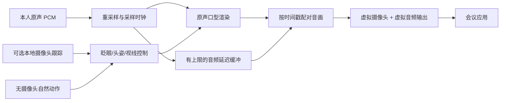

# Windows 数字形象选型与实现边界（2026-11-06）

本轮按用户新增指令推进个人数字形象、本人原声展示与全程代理，优先模拟面试和练习。当前暂不采集摄像头/麦克风、不播放声音、不调用付费服务或外发个人素材。数字人是独立可选模块，基础 Windows 安装和长会议的未验项仍然保留。

## 结论

不存在一个已核实能在本机同时满足“高保真、准确眼动/身体跟随、本人原声、低于 400 ms 新增延迟、可商用”的现成 SOTA 项目。论文榜单、推理 FPS、输出文件标注 25 fps、真正送到会议的 25 fps 是不同证据。

本地评估分为三类，并保留一条 API 对照：

1. **动作可控优先：LivePortrait / FasterLivePortrait + 原声口型组件。** 用于眨眼、头姿及相对视线调节，再接有摄像头跟踪；MuseTalk 1.5 可作为口型基线。串联后的形变和延迟必须测，不能假定两者直接叠加可用。
2. **无摄像头生成候选：SoulX-FlashHead Lite。** 作为 2026 年轻量流式模型的画质/吞吐对照。默认分块已经超过 R10 延迟目标，因此先定位为练习/录制候选，不把“96 FPS”写成真人交流已通过。
3. **可控 3D 备选：Audio2Face-3D SDK 或轻量 Talking Avatar + 自有绑定模型。** 原声驱动口型，眼球、头肩另行控制，优先评价是否能明显降低延迟并满足自然注视。其代价是个人形象建模和材质制作；照片数字人与 3D 形象不能当作相同的质量交付。同日已实现 Talking Avatar 独立 3D 预览及离线 PCM 口型推断；Audio2Face-3D 尚未部署，二者均没有真实原声音画验收。
4. **API 对照优先核验腾讯云原声音频驱动，其次 Tavus Echo / LiveAvatar LITE。** 腾讯的官方接口明确描述实时麦克风分片，Tavus 官方有原声直通示例。海外服务要另外验证大陆网络、建连、计费与停流。API 不替代本地动作控制层。

AVTR-1 是值得研究的交互前沿，但当前整套许可不适合直接并入商用底座。重型视频扩散模型保留为画质参照，不占用本机资源重复验证显然不匹配的配置。

## 用户需求的明确解释

“形象代替本人展示”让用户无需把真实摄像头画面直接展示给对方。**说什么、何时说仍由本人决定**；这个模式不经过 LLM 改写或 TTS，也不做默认声音克隆。全程代理继续属于 R11，单独启用。

### 有摄像头：本地动作驱动

- 摄像头只在用户启用本地跟踪后打开。对方接收数字形象画面，原始摄像头画面不进入输出链路。
- 提取眨眼、头部朝向、面部表情、肩膀/上身动作。摄像头是动作传感器，不要求用户持续直视镜头。
- 眼睛提供“跟随”和“自然注视”两种控制：前者保留观察到的动作；后者限制大幅视线偏移，保留真实眨眼，并叠加少量平滑的微小视线变化。参数调节先本地预览，避免一直正视、双眼漂移和左右不同步。
- 普通 RGB 摄像头的面部/虹膜关键点不是精密眼动仪：眼镜反光、侧脸、遮挡和光线会影响结果。低置信度时平滑退回待机动作，不保持异常姿态，也不自动暴露原画面。
- 身体分级：先头肩和轻微躯干位移；手臂、双手、全身骨骼单独验收。头部模型不能冒称完整身体重定向。

MediaPipe 官方提供面部关键点、表情系数与变换矩阵，以及独立的人体姿态关键点；它们是跟踪信号来源，仍需映射到实际头像渲染器。[Face Landmarker](https://developers.google.com/edge/mediapipe/solutions/vision/face_landmarker) · [Pose Landmarker](https://developers.google.com/edge/mediapipe/solutions/vision/pose_landmarker)

### 无摄像头：合成自然动作

- 不启动摄像头。使用待机、聆听、说话、暂停等状态控制微小头动、呼吸感、眨眼和注视点。
- 动作应有时间连续性和停留时间，不逐帧随机；眨眼时双眼协调，微视线变化与头姿保持合理关系，避免固定周期和机械摆动。
- 音频只驱动口型/说话节奏；没有真实动作观测时，界面明确为合成动作。不要把自动点头当作用户真实表达的同意。
- 自然度需要以无声视频和正常音画分别评审；“动作参数有变化”不能作为自然度通过的证据。

### 原声与口型同步

采用音频采样位置作为媒体时间基准，视频帧和跟踪信号对齐同一时间线。本人原声可以适度延迟发送，但延迟只能改善同步，不能消除互动等待。若模型先攒 960 ms 音频才推理，增加音频缓冲无法把它变成 400 ms 的链路。

会议应用须选择配对后的虚拟音频，避免同时发送未延迟麦克风形成双声。自己监听对方的声音不跟随延迟。视频停顿时短时维持画面、缓冲设置上限；超限停止输出并提示恢复选择，不无界堆积、不丢掉一段本人发言后假装成功。切回真实摄像头必须是用户显式动作。

API 返回的同步音画应作为一个整体接收，不再给已经同步的返回音频重复加一遍延迟。WebRTC 预览成功还需要虚拟设备桥接和会议对端验证；不等于飞书已经可用。

## 本地项目：研究前沿与可部署性分开

以下性能均为上游报告，除特别标注外没有在本机复测。扫描包含 2026 年发布/更新项目，不宣称覆盖所有论文，也不跨数据集拼接一个总榜。

| 项目 | 已核实能力与近期信息 | Windows / 16GB / 本需求判断 |
| --- | --- | --- |
| [SoulX-FlashHead](https://github.com/Soul-AILab/SoulX-FlashHead) | 2026-02 发布；1.3B；Lite 官方报告单 RTX 4090 96 FPS，Pro 单 4090 10.8 FPS | Lite 入选本机候选；4090 成绩不能外推成 4070 Ti SUPER 实测。原生 Windows 依赖需要适配；未发现眼动/身体关键点直控接口 |
| [AVTR-1](https://avtr-1.avaturn.live/) | 2026 技术报告；双音频驱动说话/聆听；153M 动作模型；官方报告 RTX 4060 Ti 每 5 帧约 162 ms | 有价值的交互参照；当前 README 要求 Linux/CUDA/TensorRT。模型、渲染器、服务端分别授权，不能整体按宽松开源集成 |
| [LivePortrait](https://github.com/KlingAIResearch/LivePortrait) / [FasterLivePortrait](https://github.com/warmshao/FasterLivePortrait) | 前者表情/头姿与眼唇重定向；后者 ONNX/TensorRT、摄像头路径、Windows 说明，作者报告 3090 单帧全流程 30+ FPS | 有摄像头动作控制优先候选；不是完整全身模型，也不因眼睛开合可调就认定有精确注视方向控制。InsightFace、JoyVASA 等依赖逐项核查 |
| [MuseTalk 1.5](https://github.com/TMElyralab/MuseTalk) + [LiveTalking](https://github.com/lipku/LiveTalking) | MuseTalk 2025-03 的 1.5 为口型基线，处理 256×256 面部区域；LiveTalking 提供会话、打断与输出编排 | 工程基线而非最新整体数字人 SOTA。视频底图的眼神/身体不会自动变成当前用户动作；还需原声流式入口与虚拟输出验证 |
| [EchoMimicV3-Flash](https://github.com/antgroup/echomimic_v3) | 2026-01 更新，官方列出 8 步、12G 显存路径与最高 768×768 | 可作为录制画质对照。能装入显存不代表实时，不预设满足连续麦克风延迟 |
| [Alibaba LiveAvatar](https://github.com/Alibaba-Quark/LiveAvatar) | 14B、长时流式；官方 45 FPS 来自多 H800；2026-01 FP8 路径面向 48GB 显卡 | 不进入本机 16GB 首轮。**与 HeyGen 商业 LiveAvatar 不是同一个产品** |
| [LongCat-Video-Avatar 1.5](https://arxiv.org/abs/2605.26486) | 2026-05，强调半身/全身动作、长视频与身份一致性 | 画质参考；官方集成方 vLLM-Omni 的 H100 路径峰值约 41 GiB、目前离线推理，不能据此当作本机实时方案。[部署记录](https://github.com/vllm-project/vllm-omni/blob/main/recipes/meituan-longcat/LongCat-Video-Avatar-1.5.md) |
| [StreamAvatar](https://streamavatar.github.io/) / [EchoAvatar](https://robinwitch.github.io/EchoAvatar-Page/) | 2026 前沿：分别涉及流式说话/聆听与音频驱动全身动作 | 保留追踪；本轮未核完可用权重、Windows 依赖与整套许可证，不列入已可部署名单 |

### 三个决定性源码发现

**FlashHead 的吞吐不等于低延迟。** 固定源码 `9bc03de` 的 `infer_params.yaml` 为 33 帧/25 fps；Lite 权重配置时间步长为 8，历史动作帧数为 `(2−1)×8+1=9`，每批新音频为 `(33−9)/25=0.96 s`。`gradio_app_streaming.py` 先读音频文件、合并 3 批再输出 MP4；不能直接改个摄像头入口就声称实时会议。原生依赖含 NCCL，模型模块顶层导入 xfuser；单卡设备分支存在，但仍须解决导入依赖。模型有 PyTorch SDPA 回退，不必直接认定一定要强装 FlashAttention。[源码](https://github.com/Soul-AILab/SoulX-FlashHead/tree/9bc03de06bb0de82cd6bc477804512ae06144bf2) · [Lite 配置](https://huggingface.co/Soul-AILab/SoulX-FlashHead-1_3B/blob/5fbd2e44ba08ab2deb28bd55cff2c15523e51ba5/Model_Lite/config.json)

**FlashHead Lite 并非整包 Apache-2.0。** 模型卡分别列出 DiT/音频编码器的 Apache-2.0 与 Lite 使用的 LTX VAE 的 Open-RAIL-M；发布时保留分别对应的许可，不能只复制 GitHub 根目录 LICENSE。[模型卡](https://huggingface.co/Soul-AILab/SoulX-FlashHead-1_3B)

**AVTR-1 不是整套免费商用开源。** 当前许可图明确渲染器和 Streamer 为 PolyForm Noncommercial；权重另有 Community License，另依赖 InsightFace 权重限制。故本轮只保留源码审阅，不复制其渲染/调度实现进入听弦。[许可图](https://github.com/avaturn-live/avtr-1/blob/eb1e5a89ed7bec3debe712b090efd676b3a420bd/LICENSE.md)

### 近月更新补查与可控 3D 路线

2026-11-06 补查 8—10 月的新发布及更新，并回到官方仓库和模型卡核实。以下只是新增资料审阅，不计入上述 6 个本地 checkout 或已运行模型。

| 候选 | 官方材料与判断 | 对听弦的决定 |
| --- | --- | --- |
| [OpenSpline](https://github.com/openspline/openspline) | 提供 PCM 流、播放完成、打断、持续待机和会话编排；底层明确基于 SoulX-FlashHead。自托管说明为 Linux / WSL2；封装 MIT，内含推理代码及权重分别授权 | 作为 FlashHead 的集成参考，不作为独立新模型 SOTA。README 明确区分引擎 FPS 与播放延迟；不能直接沿用社交媒体的 90+ FPS 作为本机结果。未运行安装脚本，未打开其云服务 |
| [PersonaLive](https://github.com/GVCLab/PersonaLive) → [EditaLive](https://github.com/GVCLab/EditaLive) | 后者 2026-09-14 发布推理代码与权重，扩展全身角色驱动/编辑；基于 Wan2.2-Animate-14B，页面报告 14.47 FPS。两者 README 均明确 academic research only | 符合“摄像头动作转移”的研究方向，但当前许可和硬件/速度证据不支持并入商用 Windows 底座；停止下载大型权重 |
| [KlingAIResearch/AvatarForcing](https://github.com/KlingAIResearch/AvatarForcing) | 1.3B，一步流式扩散；论文报告 832×480、34ms/frame。README 末尾称 Apache-2.0，但 [LICENSE.txt](https://github.com/KlingAIResearch/AvatarForcing/blob/main/LICENSE.txt) 含仅限学术、禁止商业/生产的条款，且沿用 RollingForcing 名称 | 记录许可冲突，不自行认定 README 优先，不接入。其 local-future/look-ahead 也需单独核算输入等待；34ms/frame 不能推导端到端 34ms。与另一篇题名含空格的 Avatar Forcing 论文区分 |
| [NVIDIA Audio2Face-3D SDK](https://github.com/NVIDIA/Audio2Face-3D-SDK) | 原声音频转面部动画，官方支持 Windows 10/11；SDK MIT，模型另用 [NVIDIA Open Model License](https://huggingface.co/nvidia/Audio2Face-3D-v3.0)。当前 SDK 要求 CUDA ≥12.8 且 <13、TensorRT ≥10.13 且 <11 | 3D 原声口型优先备选。它不生成个人的完整 3D 形象，也不自动提供眼神/身体跟踪。现有 torch cu130 成功不能证明 SDK 环境兼容，应隔离构建；不修改现有环境 |
| [InterviewFlowAI/Talking Avatar](https://github.com/InterviewFlowAI/talking-avatar) | 浏览器 Three.js 3D 头像、约 1 MB 本地口型模型；支持原声 MediaStream，默认延迟 150ms。上游称 SDK、模型、内置形象均 MIT；文档明确目前没有眼神和头部动作，训练以英语为主，中文音素近似 | 可作轻量原声同步和 3D 结构对照，不能宣称已满足自然注视或个人高保真。默认加载 CDN 资源且直接播放音频，离线测试须改为本地资源并审阅输出路径；本轮不启动演示 |
| [Meta Muse Realtime Avatar](https://research.meta.ai/blog/bringing-your-muse-to-life) | 2026-09-23 官方技术说明：448×768、25 FPS，约 870ms 从用户话轮结束到同步音画首字节，硬件口径为 GB200 | 更新画质/系统设计参照。该发布页未提供可供本轮本地部署的权重或通用原声 API 入口；870ms 不是用户连续原声转发延迟，不列入本机可部署清单 |

选型变化：原先单纯比较照片动画模型不足以回答眼动和身体控制问题，增加 **3D 可控性验证**。这是一条工程假设：绑定模型允许分别控制眼球、眨眼、头肩和口型，可能比扩散视频更容易守住实时预算；尚没有本机实测证明，不能当作最终胜出方案。轻量 Talking Avatar 自身缺少眼神/头部动作，必须补齐控制接口后才能检验这个假设。

个人形象创建也分开验收：单张授权照片的检测/裁切与身份保持、3D 形象的建模/绑定、供应商的个人形象注册是三种不同交付。当前本地 SD-Turbo 虚构肖像只为测试出画，不能代替这三项中的任何一项。优先验证受控正面照片路径，再按渲染器选择决定是否投入 3D 建模或云端个人形象创建。

进一步源码检查补充：LivePortrait 的 [Gradio 编辑管线](https://github.com/KlingAIResearch/LivePortrait/blob/9b294b3d0536135442ea73cb01e6cb3ca7029dd3/src/gradio_pipeline.py) 已有 `update_delta_new_eyeball_direction`，本轮将其 MIT 偏移映射移植到独立适配器，保留许可并以合成照片验证。因此无需先切换 3D 才能获得相对视线控制；它仍不是精确眼球角度或用户眼动测量。Talking Avatar 固定版本的两个 GLB 各有 67 个表情目标及眼球/头/颈骨骼，具备扩展控制的资产结构，但原 SDK 没有暴露对应控制，尚未实际渲染验证。

## 商业 API 的可行性

选择标准是“接收本人已经说出的原声音频并渲染”，不是“能让 AI 数字人回答”。后者可用于 R11，但不能替代 R10。

| 供应商/模式 | 原声入口与控制证据 | 采用判断 |
| --- | --- | --- |
| [腾讯云智能数智人](https://cloud.tencent.com/document/product/1240/100398) | WebSocket `SEND_AUDIO`，16kHz/16bit/mono PCM；明确写出麦克风每 160ms 发送；同一段 ReqId、递增 Seq、空 final 包、Interrupt；支持形象预置动作 | 国内 R10 首个接口对照候选。动作指令不是实时眼动/骨骼透传，创建个人形象、费用与返回音画延迟需账号实测 |
| [Tavus Echo](https://docs.tavus.io/sections/conversational-video-interface/quickstart/pipeline-modes) | 支持直接文本/音频驱动，绕过大部分对话管线；官方有[用户原声直通示例](https://github.com/Tavus-Engineering/tavus-audio-passthrough-demo) | 原声语义匹配；需验证两段 RTC/重采样成本、地域可达性、价格和实际停流。Echo 不等于默认全套感知能力 |
| [HeyGen LiveAvatar LITE](https://docs.liveavatar.com/docs/lite-mode/events) | 24kHz/16bit/mono PCM，`agent.speak` / `speak_end` / `interrupt`，聆听状态控制；建议约 1s 音频片 | 可作 API 同步/画质对照。推荐分片已经对低延迟真人交流不利，必须单独验证更小分片，不能提前承诺 ≤800ms |
| [Anam audio passthrough](https://anam.ai/docs/javascript-sdk/examples/custom-tts) | 支持提供 PCM、结束序列和打断，禁用其默认音频输入与内置 AI | 备选；文档示例主要针对外部 TTS，连续 1× 本人音频的缓冲/自然停顿表现仍待测，不能只看示例成功 |
| [Simli](https://docs.simli.com/api-reference/audio-info) | 原始 16kHz PCM16 mono；有自定义形象和实时输出 SDK | 轻量 API 备选；模型/动作控制和自然度需实测。文档索引把部分动画控制列为 coming soon，不能当作已可用的身体跟随。[当前索引](https://docs.simli.com/llms.txt) |
| [火山 Flowact-R1 实时数字人](https://docs.volcengine.com/docs/large-model-of-image-generation/real-time-interactive-digital-human-api-interface-documentation?lang=zh) | 16kHz PCM 流（片长≥40ms）与 Prompt 动作/表情指令；与离线 OmniHuman 产品区分 | 生成动作路线可研究；SDK 产品页当前为 480p/25fps，首帧约 2–3s，不能直接承诺 R10 门槛。动作提示不是逐帧重定向 |

费用只记录本轮官方可核实项目：LiveAvatar LITE 为 **1 credit/会话分钟**（不是只按说话分钟），Essential $99/月、1,100+10 credits；Business $475/月、6,000+10 credits，超额分别 $0.095/$0.09 每 credit。60 分钟 LITE 消耗约 60 credits，实际单次会话时长限制要另查账号；不因有分钟额度就认为能连续一小时。[官方计费](https://docs.liveavatar.com/docs/faq/credits)

火山该 SDK 产品页当前标价 **1 并发包月 42,000 元、包年 420,000 元**，要求先确认资源；这是具体产品规格，不泛化成火山所有数字人接口统一价格。暂不作为个人练习阶段首个付费尝试。[官方产品与计费页](https://docs.volcengine.com/docs/large-model-of-image-generation/real-time-interactive-digital-human-sdk-product-introduction?lang=zh)

Tavus 公共价格页在本轮返回的内容含新旧重复方案，未采纳冲突数字；腾讯、Anam、Simli 的本次可用账号、个性形象成本和实际套餐尚未核验。统一成本比较应计算形象创建、会话占用时长、并发、RTC/带宽、超额、断线后计费和税费。[Tavus 价格页](https://www.tavus.io/pricing)

本轮没有注册、开通付费、联系厂商或发送声音/肖像。真实 API 测试前集中确认账号、额度、合成测试外发及地区条件；不从旧配置恢复凭证。

## 集成结构与下一步实验

保留现有 Tauri/Rust/React，独立本地渲染服务通过能力表声明 `audio_input`、`blink_control`、`gaze_control`、`head_pose`、`upper_body`、`interrupt`、输出时间戳及真实支持的分辨率。未知能力不能默认标 true。展示窗口仍只读，不持有 Key、不自行采集或发起模型请求。

R10 只接原声；R11 在同一媒体入口上接授权 TTS 输出，但必须区分 `self_actual` 与 `proxy_emitted`，不能把草稿或尚未输出的音频记入本人已说内容。输出适配器负责独立 session/generation、缓冲上限、设备恢复和本地接管，不依赖云端确认才停止本机播放。

| 实验 | 假设 / 能改变的决定 | 停止条件 | 证据与受影响产物 |
| --- | --- | --- | --- |
| E01 GPU 小运算 | 驱动能真正承载当前 torch CUDA；决定能否开始本地模型实验 | 一次正确矩阵运算，或明确的加载/设备错误即止 | 实机运行环境；不能推导数字人 FPS |
| E02 固定源码与许可审计 | 候选公开实现适合本机延迟与授权；决定是否下载权重、移植 | 发现决定性的延迟/许可/平台限制后不继续昂贵全配置实验 | 来源锁定、选型报告；FlashHead 默认延迟、AVTR-1 许可边界 |
| E03 原声分片合成回归 | 不同输入边界仍保持全部样本、顺序、结束和取消隔离 | 协议契约与样本守恒通过；失败先修根因 | 可复用原声分片模块；不是 API 接入验收 |
| E04 可控头像无声渲染 | 合成肖像 + 预设动作可输出稳定头姿/眨眼；决定保留何种渲染器 | 模型依赖不匹配、OOM 或时延明显不达标时记录并停该路径 | 先 10s 视频与原始逐帧计时；再决定是否做 30min |
| E05 原声音画闭环 | 本人音频 1× 输入 + 有界延迟能自然交流 | 等用户允许采集；短片达不到同步/时延目标则不直接做 60min | 采样 PTS、实际输出帧、P50/P95 延迟、远端录制 |
| E06 API 配对对照 | 同一合成输入的云渲染能带来有价值的画质/延迟收益 | 获外发与额度许可后，只跑有决策价值的候选；超预算/断线停止 | 计费、连接和播放时延；不自动切供应商 |
| E07 可控 3D 可行性 | 绑定形象能独立表达视线/眨眼/口型并降低负载，决定是否增加第二渲染后端 | 先静态资源及许可审阅、无声动作；若无合适绑定或控制接口即停止扩展，不先安装全套重型工具 | 合成头像无声预览、控制能力表；不等于真人高保真或原声闭环 |
| E08 解码器布局 | channels-last 能减少至少 20% 帧耗时且保持画面，决定是否保留轻量优化 | 一次 50 帧成对比较；未达到收益或图像容差即停止 | 实测反而慢约 2.5%，候选未进入实现；分段数据用于定位 |
| E09 相对视线/待机 | 官方视线偏移能与眨眼组合、归零后无身份漂移，决定是否保留照片路线 | 7 个静态控制及 10 秒视频；冲突/漂移即停止修复 | 静态组合检查通过，250 帧无声待机已出画；连续自然度和跟踪另验 |
| E10 离线 PCM 口型 | 小模型能保持分片与时间线一致且计算负担可控，决定是否继续实现实时原声入口 | 参考输出、分片、静音、结束、取消或短片推断明显失败就定位；通过后不重复短跑代替同步实测 | 17 项前端专项回归；中英文合成 WAV 推断与无声 UI；不是麦克风或真实音画闭环 |

验收自然度时检查眨眼时序、视线漂移、双眼一致、嘴眼冲突、肩颈稳定、遮挡恢复、长静默、中文/英文术语、快速打断。相同素材比较不同引擎；不能用不同素材和硬件的演示视频宣布一个唯一 SOTA。

当前执行证据见 [本轮验收记录](avatar-validation-2026-11-06.md)，候选版本见 [来源锁定](../avatar/sources.lock.json)。

E07 后续已运行独立 [3D 无声预览](../avatar/web-preview/README.md)：两个 Rocketbox 示例实际出画，增加世界坐标头姿、相对视线和闭眼控制，手动口型与本地 GLB 导入可用。发现并修正骨骼局部轴导致左右转头变成侧倾的问题；8 项回归和构建通过。十秒浏览器绘制提交约 155.5 次/秒、间隔 P95 6.6ms，只衡量提交节奏，未计 GPU 完成、编码或会议，因此不能与 LivePortrait 24.80fps 渲染+编码作等口径性能排名。决定保留轻量 3D 作为第二后端候选；没有替代个人照片还原需求，也没有把手动口型当作原声同步。

同日续测：官方 LivePortrait 已在本机通过 PyTorch CUDA 生成 10 秒合成肖像头姿/眨眼视频，实际解码 250 帧。排除 PNG 取证写盘后的渲染+编码基线 **24.79 fps**，仍未达到持续 ≥25 fps，且为 512×512 离线产物；早期含取证开销的 23.51/24.61 fps 记录保留并明确范围。该证据将“可控头像能否出画”由待测变为已证实，但不改变原声口型、视线/身体、安装版和会议验收仍缺证据的判断。

E10 后续保留 Talking Avatar 的纯 PCM 推断与口型映射，模型从本机读取并校验 SHA-256，没有导入其音频播放器。23.705 秒中文合成语音在 Node 中总推断约 **518.69ms**，18.815 秒英文约 **405.50ms**；20ms 输入分片的 CPU 推断 P95 分别约 **0.59ms / 0.53ms**。这是整段文件快速计算，尚未接音频设备。模型逐帧输出与上游提供的 PyTorch 参考夹具完全一致；该比较没有重新运行 PyTorch。

决定继续验证轻量本地原声链路，但不承诺现成 150ms 产品延迟：模型 25ms 窗口、20ms lookahead 之外，还存在事件稳定、重采样以及口型平滑最多 250ms 邻域和提前起口。当前全文件先分析再预览，知道未来的事件和时长；实时版必须约束未来窗口和输出缓冲。中文只验证能输出事件和驱动模型，未评估发音准确度、英语术语的中文合成读音质量或自然度。商业 API 保持腾讯 / Tavus 原声入口的配对对照候选，不因本地离线成功而关闭，也未发起任何真实调用。
