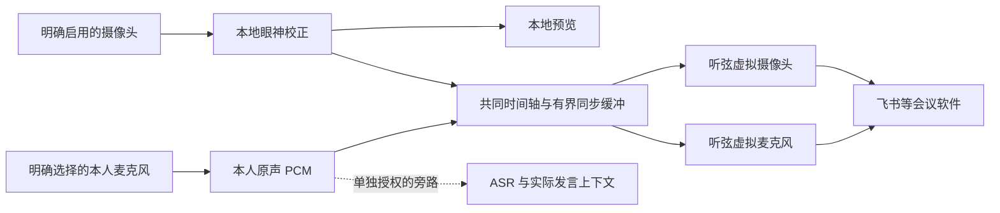

# R10E 同步画面与本人原声

需求修订 ID：AV-SYNC-20261107。依据：2026-11-07 用户明确要求听弦接收原始音视频，
校正眼神，再把同步后的画面和本人原声交给会议软件。本文件补充 PRD v2.1 第 4.5 节，
覆盖旧版“会议直接使用真实麦克风、虚拟麦克风后置”的范围。它是需求与接入契约，
不是已经实现音频设备、同步调度或通过会议验收的声明。

续作：[AV-E1 时间线第一部分](eye-av-timeline-validation-2026-11-07.md) 已完成源位置映射
与有界窗口的本机合成回归。下文第 2/7 节保留需求修订时的基线，最新实现以续作记录为准；
音频端点、完整调度、实际安装版与会议验收仍未完成。

## 1 目标与保留边界

“语音截取”是获取本人麦克风的原始音频流。对外原声不等待识别结果，不来自文字、
AI 回答或参考答案。允许必要的格式转换、漂移补偿和有限缓冲，不生成或替换本人声音。
保留真实口型、身份、表情、身体与背景；只有眼区及必要融合边缘经过校正。

眼部仍为可选模块，无 GPU/运行时/媒体组件时原有转写、资料、问答和教育功能可用。
完整数字人、照片注册、口型生成、TTS、换脸模型与全程代理继续冻结/后置。
EDU-M0/M1 不依赖本链路；M2/M3 不因本次需求变更启动。

预览、处理、原声采集、ASR、视频输出和音频输出有独立状态与授权。只有两路端点及
时间线都有效才能进入同步输出状态。视频单独使用可保留，但明确未同步原声。
恢复只恢复偏好，不恢复采集或输出。当前本轮无真实摄像头、麦克风、播放或外发授权；
本文件不会启动设备，不修改防护、系统默认设备或当前会议设置。

## 2 源码核对与真实缺口

核对基线：眼部输出 `0a2fb386bfa19eba8bdda430c5d506cdd1942ac3`（功能 `6cbc2dc`）；
教育独立分支 `ac958f66e06bbae938718988faa4d5feb60f8508`（功能 `0527d2d`）。
两路代码没有合并；Mac 新增提交保留。下表是源码检查，不是本轮运行结果。

| 位置 | 已有行为 | 同步目标缺口 |
| --- | --- | --- |
| `video/eye/stream_protocol.h`、`crates/video-worker-control/src/stream_windows.rs` | generation、帧 ID、GetTickCount64 采集毫秒数沿视频管道传递 | 没有音频设备样本位置、QPC 映射和共同输出排期 |
| `video/windows/frame_mailbox.h` | 有界最新帧、原采集时间过期检查、停止中性画面 | 视频替换策略不能直接用于连续 PCM |
| `video/windows/source.cpp` 的 `RequestSample` | 在请求样本时用 `MFGetSystemTime()` 设置样本时间 | 是视频 v1 的供帧时间，尚未贯通原音视频共同采集时间线 |
| `video/windows/output_bridge.*`、`crates/video-worker-control/src/preview.rs` | 校正帧预览与显式原生视频转发分路 | 没有同步音频端点/调度；当前管道版本不能冒称 A/V 协议 |
| `frontend/src-tauri/src/interview_video.rs` | 主窗专属组件检查、停止和退出保护 | 尚无主窗实时媒体所有权或同步启动命令 |
| `frontend/src-tauri/src/audio_v2/sync.rs` | `AudioSynchronizer` 带 TODO，返回空列表 | 不是可复用的已验收音画同步引擎；文件注释不作为完成证据 |

已有视频 CI/合成 MF 像素检查只证明其记录的范围。原基础安装阻塞、目标机新安装版、
NVIDIA 流式 worker 隔离与实际 SDK、真实人物自然度、物理采集、虚拟设备和会议门槛均保留。

## 3 共同时钟与有界调度契约

1. **采集时间独立于到达/完成时间。** 原生端记录 `stream_id`、同步 generation、序号、
   `capture_pts_100ns`、clock_id/映射版本和时间质量。视频还记录 SDK 完成时刻；音频
   记录首样本位置、帧数、采样率、声道与格式。不能用完成时间覆盖采集时间。
2. **显式时钟映射。** WASAPI `IAudioCaptureClient::GetBuffer` 提供首样本设备位置和
   对应的 100 ns QPC 时刻；处理 SILENT、DATA_DISCONTINUITY、TIMESTAMP_ERROR。
   `IAudioClock::GetPosition` 的位置单位须配合 `GetFrequency`，不能当作固定采样帧数。
   原始 QPC ticks 必须按频率转换，不能与 GetTickCount64 毫秒或 MF 时钟直接相减。
   摄像头源时间、音频输入与输出时钟映射需各自核验、持续观测；休眠/拔插/时钟倒退
   使映射失效，重新准备且不自动复播。[采集时间接口](https://learn.microsoft.com/en-us/windows/win32/api/audioclient/nf-audioclient-iaudiocaptureclient-getbuffer)、[设备时钟接口](https://learn.microsoft.com/en-us/windows/win32/api/audioclient/nf-audioclient-iaudioclock-getposition)。
3. **排期与漂移。** 依据对应采集时刻安排呈现，目标延迟包括已观测的眼部耗时和两路
   设备缓冲；持续估计漂移并用有界速率调整/重采样补偿，不能一次设延迟后放任漂移。
   保持连续语音与单调 PTS，延迟收缩不批量跳过有效语音；超出补偿范围进入明确故障。
   调度必须考虑实际音频端点消费位置，不能只检查应用提交的时间相等。
4. **硬上限。** 每路队列显式限制时间、数量和字节，拒绝未来、旧代次和无效格式。
   过期视频丢弃并计数；连续音频按序消费，欠载只补静音且计数，不能重播旧声音。
   正常语音不能按视频策略任意替换为“最新一块”。超限时安全暂停而非无限积压。
   具体上限在首个合成实验固定并报告，未核对前不填入产品默认值。现有视频 250 ms
   过期租约继续有效；新增缓冲必须计入该时间，不能刷新采集时间来延长租约。
5. **协议演进。** 新时钟/PCM/呈现时间使用明确版本与能力协商；保留 v1 视频路径，
   不重新解释其 `captured_ms` 字段，不把旧组件当成支持同步。原始 capture PTS、
   计划呈现 PTS、实际提交时刻和设备消费位置分列；旧组件不支持时返回不可用。
   MF 的呈现时钟用于调度，但两个独立虚拟设备不会因共享一个字段自动成为同一
   媒体会话；适配层仍需验证时间域和会议客户端行为。[MF 呈现时钟](https://learn.microsoft.com/en-us/windows/win32/medfound/presentation-clock)。

本机视频原目标仍为采集回调到虚拟提交 P95 ≤50 ms、P99 ≤100 ms，包含新同步等待。
同时报告处理、等待、提交、音频附加延迟及接收端总延迟；若目标冲突，保留失败并重新
评估实现，不以改计时起点、删除慢样本或放宽 P95 掩盖。接收端偏移目标不等于总延迟目标。

## 4 输出、来源与停止

`AudioOutputSink` 是会议软件可选择的系统录音端点对应的适配器，不是 WAV 文件、
内存队列、默认扬声器或 ASR 输入。准备/写入/消费/接收端收到分别记状态。若采用虚拟
线缆的 render→capture 配对，必须核验对应端点 ID、归属、格式和消费时钟，不能只按
显示名称选择或改系统默认设备。产品目标名为“听弦虚拟麦克风”，第三方桥接仍标明实际组件。

输入仅准入用户选择的本人麦克风；拒绝系统 loopback、对端/混音、输出端点回采。
数字来源正确不能保证没有声学回声；耳机和后续真实会议验证仍必要。ASR 旁路独立有界，
ASR 阻塞/关闭不影响原声输出，媒体故障也不清空其他会话资料。

同步会话、两路端点各有代次/租约。取消、换设备、格式变化、权限撤回、模型故障、
掉线或主进程退出，默认一起撤销同步输出：中性视频、静音、清空应用及设备侧待播区间，
旧回调拒绝。端点看门狗必须在主进程消失时独立生效。停止确认不等于能撤回已被会议
客户端接收或发上网络的片段；这部分尾部在接收端测量。没有确认排空/释放时禁止新代次。
失效不自动切换物理麦克风或原摄像头；用户明示的原画面回退也不能绕过原声权限/代次。

主窗口拥有捕获、同步和设备生命周期；展示窗只读，不获取媒体句柄、权限、Key 或启动能力。
UI 分清预览、处理、视频输出、原声输出及同步就绪/故障；本机不能自行证明会议选中了端点。

## 5 虚拟麦克风实现的选择门槛

现有 MF 虚拟摄像头不能凭增加音频引脚就推定为通用系统麦克风。候选需实际证明在
目标 Windows/会议客户端可枚举、收取 PCM、报告消费时钟并按停止语义静音。

- 优先调查已有受支持、签名可信且许可允许的音频端点方案，分别核对使用、开发、
  再分发、设备命名及普通用户安装；未确定方案，不默认购买或捆绑第三方驱动。
- Microsoft 的 [SysVAD](https://learn.microsoft.com/en-us/samples/microsoft/windows-driver-samples/sysvad-virtual-audio-device-driver-sample/)
  是 WDM/WaveRT 驱动示例，可供接口研究，不是可直接安装交付的听弦麦克风。
  自研方案需单独评估 WDK、实现、签名、安装/升级/卸载与安全启动兼容。
- 正式签名按[微软驱动签名要求](https://learn.microsoft.com/en-us/windows-hardware/drivers/dashboard/code-signing-reqs)
  核实；示例中的测试签名部署流程不在当前机器执行，不关闭 Secure Boot、防护或签名检查。
  未具备可合法部署的端点时继续纯合成调度验证，但设备/会议门槛仍为未通过。

这里只核查官方接口与交付限制，没有下载、编译、安装或运行 SysVAD，也未选定收费方案。

## 6 下一轮实验与出口

以下均为待执行，不计入既有测试通过数量。每轮先固定输入、版本、缓冲硬上限及证据目录。

| 阶段 | 假设 / 决策价值 | 停止条件 | 影响产物 / 证据边界 |
| --- | --- | --- | --- |
| AV-E1 合成时间线 | 连续 PCM、变动眼部耗时与不同设备时钟可有界对齐；决定核心时钟/调度接口 | 时钟单位混淆、错源、旧代次回放、无界队列或未记账丢失 | 同步核心；纯内存不播放，不证明设备或自然度 |
| AV-E2 音频端点 | 受支持方案可在正常防护下暴露麦克风并消费合成 PCM；决定端点供应商/自研路线 | 许可、签名或安全安装不满足；不得降低防护 | 独立端点与安装契约；需相应系统操作授权 |
| AV-E3 两路组件 | 校正帧与对应原声按实际消费时钟输出、异常同时中性/静音；决定接入主窗 | 固定延迟漂移、停后回播、单路失败仍显示同步 | 原生组件合成回归；不冒称飞书接收 |
| AV-E4 真实输入 | 获准后真实设备/眼部 SDK 的耗时和质量满足条件；决定默认参数 | 收音错源、过载、严重眼部失真或数据风险 | 实机短测；摄像头/麦克风须用户允许 |
| AV-E5 接收端与长测 | 双设备飞书选择两听弦端点后，30/60 分钟仍达标；决定稳定发布 | P95 偏移 >100 ms、持续欠载、不可恢复故障、安装不通过 | 接收端成绩与支持范围；不能由本地预览替代 |

AV-E1 先覆盖不同处理时延、时钟漂移/不连续、乱序/迟到、暂停与至少三次重启、
输出背压、欠载、格式变化、错误来源、同一标记的音视频对应。合成标记只写内存或独立
离线工件，不播放声音、不启动任何摄像头/麦克风。

AV-E5 用获准的可对齐事件和统一接收端观测，不能直接相减两台未校时机器的时间。
报告绝对偏移 P50/P95、有符号偏移/随时间漂移、样本/失败数、误差、总延迟、唯一/重复/
占位/丢帧、音频静音/欠载/丢失区间及资源。所有失败和慢样本保留。

## 7 本轮交付边界

本轮完成范围修订、官方接口核查、源码缺口定位、EDU 已交付记录复核和文档一致性检查。
没有实现或运行新的同步核心、音频捕获/输出设备；没有新安装包，没有改变现有进程或用户资料。
后续从 AV-E1 与独立端点可行性调查推进；媒体路线和教育路线保持独立提交，禁止整分支
合并旧数字人。安装、真实模型、真人学习效果、SDK 商业分发和长会议仍分别待验收。

文档 UTF-8、围栏、表格列数、相对链接、两分支共享条款一致性与旧冲突条款检查通过。
30/30 教育研究文件的大小/摘要一致；六份历史 EDU 回归/CI 证据摘要匹配，CI 日志对应
`0527d2d`，核对到 25 个前端脚本、核心各测试程序合计 56 项及应用选定 4 项通过。
GitHub [教育 CI 42361975990](https://github.com/Jinchun-Liu/TingXian/actions/runs/42361975990)
和[视频 CI 42368116754](https://github.com/Jinchun-Liu/TingXian/actions/runs/42368116754)
当前仍为成功；属于历史功能源码，本轮未重跑，也不证明新的音频同步目标。

本机证据位于源码外 `artifacts/2026-11-07/av-sync-scope-001/`。首次跨分支文档 patch
因教育专属上下文不同被 `--check` 拒绝，未写入；改为确认原正文完整匹配后同步，保留
教育入口与专属约定。审计脚本首次误把核心合计 56 项当成一行结果，修正为逐测试程序
汇总，并独立核对应用 4 项；失败记录保留，没有修改产品代码或历史日志。
